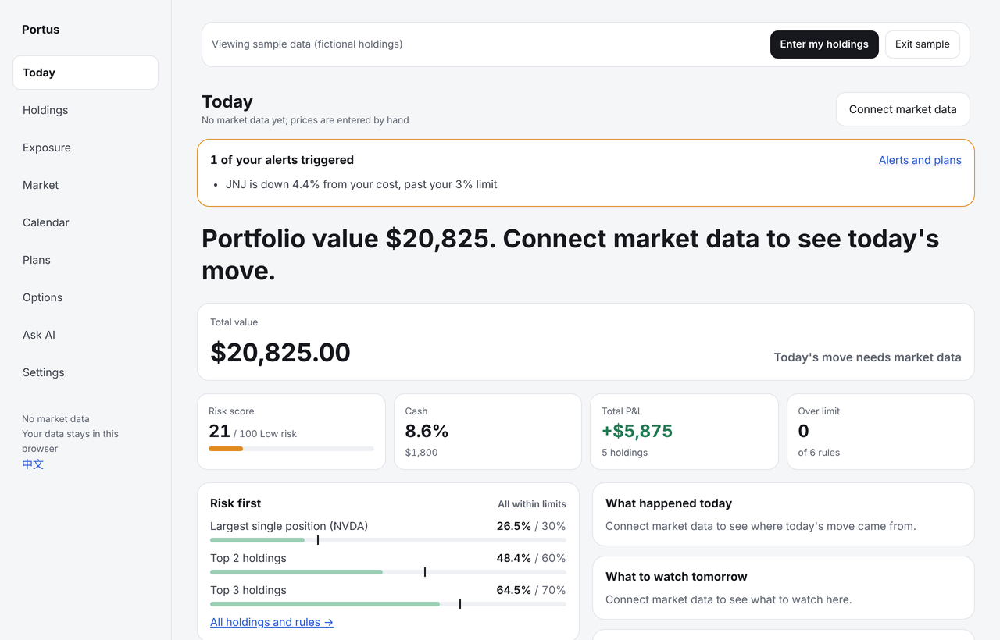
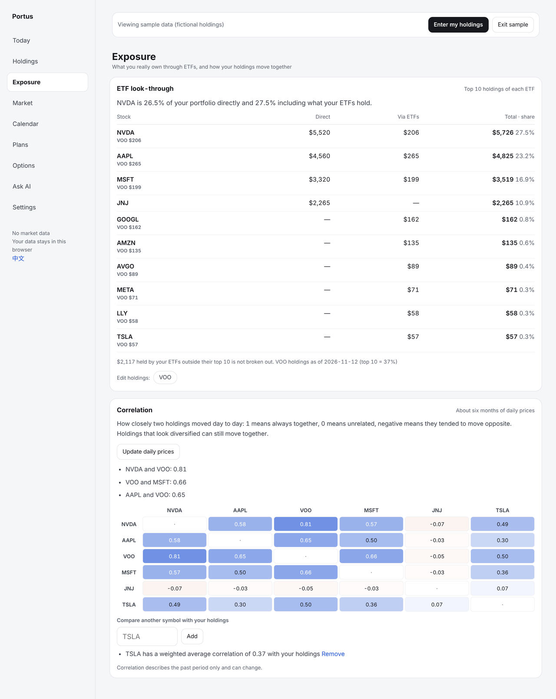
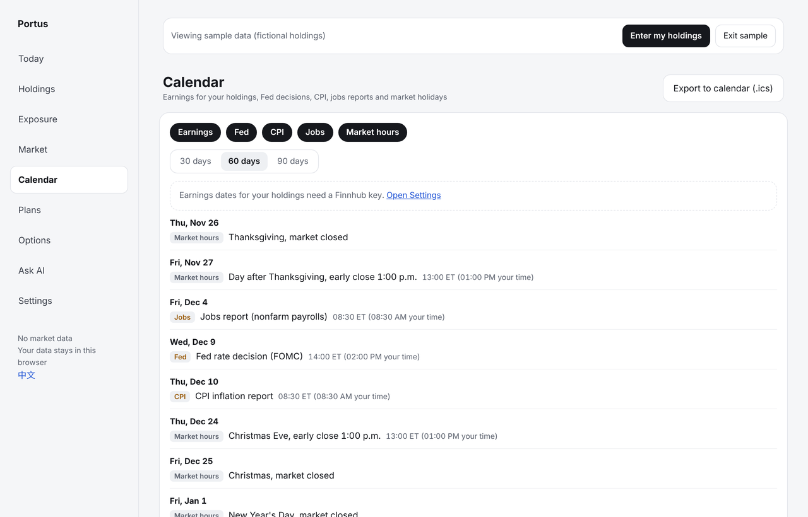
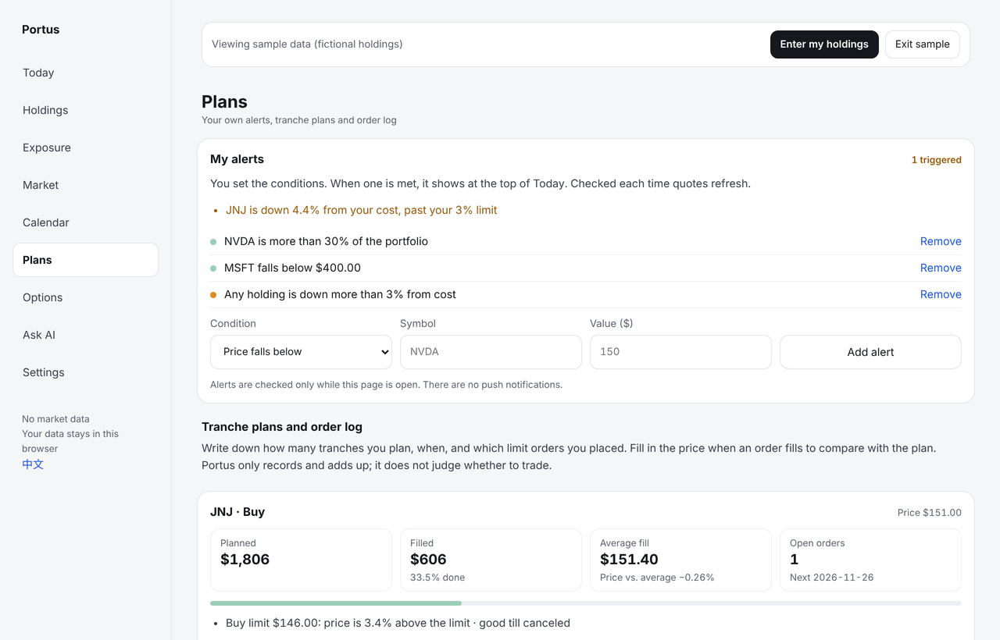

# Portus

An open-source, local-first dashboard for all your brokerage accounts. Import each broker's CSV (or type holdings in), and see the whole picture in one place: combined positions, concentration, ETF look-through, correlation, events and your own plans. Everything stays in your browser.

**Try it:** [pixelbluellc.com/portus](https://pixelbluellc.com/portus/) · [中文说明](#中文)

> **Not investment advice.** Portus is a research tool. It does not connect to brokers, place orders, or give buy/sell recommendations or signals. It only calculates facts and checks rules you set yourself.



## What it does

- **Today**: one-line summary of the day, where gains and losses came from, risk score, concentration breaches, your triggered alerts and the next 7 days of events.
- **Holdings**: every account combined (or split by account), allocation, cost vs. price, P&L, 52-week range, concentration rules with thresholds you set.
- **Exposure**: ETF look-through (how much NVDA you really own once SPY and QQQ are broken down) and a correlation matrix of your holdings, plus any symbol you want to compare.
- **Market**: sector ETF moves and news for your holdings. In the Chinese interface, headlines are machine-translated with your own Anthropic key.
- **Calendar**: earnings dates for your holdings, Fed decisions, CPI, jobs reports and market holidays. Export to Apple Calendar, Google Calendar or Outlook (.ics).
- **Plans**: your own alerts (a price level, a daily move, a position or sector weight) and a log of tranche plans and limit orders, compared with what actually filled.
- **Options**: import an option chain exported from your broker to see at-the-money IV, expected move, max pain, put/call ratio, skew and gamma exposure, plus a pre-trade checklist you fill in yourself.
- **Ask AI**: questions about your portfolio, answered from the day's data. The AI explains facts only; responses containing buy/sell language are blocked.

| ETF look-through and correlation | Calendar | Plans |
| --- | --- | --- |
|  |  |  |

_Screenshots use the built-in fictional sample portfolio._

## Data sources

Works with **no API keys** (prices come from what you enter). Optional keys are stored only in your browser and sent directly to each provider; there is no Portus server.

| Provider | Used for | Free tier |
| --- | --- | --- |
| [Finnhub](https://finnhub.io) | Quotes, 52-week range, company news, earnings calendar, industry | 60 calls/min, personal non-commercial use |
| [Twelve Data](https://twelvedata.com) | Daily prices for correlation and realized volatility | 800 calls/day, 8/min |
| [Anthropic](https://console.anthropic.com) | AI summary, Q&A, headline translation | Pay as you go |

Built in, with sources noted in the code:

- **Macro calendar** (`packages/core/src/calendar.ts`): FOMC, CPI, jobs reports and NYSE holidays through 2027, from the Federal Reserve, BLS and NYSE schedules. Updated once a year.
- **ETF top holdings** (`packages/core/src/etf.ts`): top 10 holdings of SPY/VOO/IVV/SPLG, QQQ/QQQM, SMH and XLK. Updated quarterly. You can enter holdings for any other ETF in the app.
- **Option chains**: no free source allows browser access, so you import the CSV your broker exports.

## Develop

```bash
npm install
npm run dev        # web app at http://localhost:5173
npm test           # core calculations (Vitest)
npm run typecheck
npm run build      # static site in apps/web/dist
```

```
packages/core   Pure calculation library: portfolio, accounts, concentration, risk score, alerts,
                calendar and .ics export, ETF look-through, correlation, tranche plans,
                option chain import and analytics, daily insights, CSV import, AI policy.
apps/web        React + Vite static web app (GitHub Pages). Chinese and English interface.
```

## Privacy

Holdings, alerts, plans, imported option chains, settings and API keys live in your browser's local storage. Nothing is sent to us, and there are no analytics or cookies. Export a backup from Settings before clearing your browser data.

## License

[MIT](LICENSE) © 2026 PixelBlue LLC. See [docs/TERMS.md](docs/TERMS.md) and [docs/PRIVACY.md](docs/PRIVACY.md).

---

## 中文

开源、数据只存在本地的多券商账户持仓看板。把每个券商导出的 CSV 拖进来（或手动录入），就能在一个地方看到全部：合并后的持仓、集中度、ETF 穿透、相关性、事件日历和你自己的计划。数据只存在你的浏览器里。

**在线使用：** [pixelbluellc.com/portus](https://pixelbluellc.com/portus/)（界面跟随浏览器语言，也可以手动切中文）

> **不是投资建议。** Portus 是研究工具，不连接券商、不下单，也不给买卖建议或信号。它只计算事实、检查你自己设的规则。

### 功能

- **今天**：一句话总结、涨跌来自哪里、风险分、集中度超标、你设的提醒有没有触发、未来 7 天的事件。
- **持仓**：多个账户合并看（也能按账户分开），仓位、成本和现价、盈亏、52 周区间，集中度规则的阈值由你定。
- **穿透**：把 ETF 拆开算真实持有（持有 SPY、QQQ 等于间接持有多少 NVDA），以及持仓之间、和你想对比的代码之间的相关性。
- **市场**：板块 ETF 涨跌和持仓相关新闻；中文界面下用你自己的 Anthropic key 把英文标题翻成中文。
- **日历**：持仓的财报日、美联储议息、CPI、非农和美股休市，可以导出 .ics 加进 Apple、Google 或 Outlook 日历。
- **计划**：你自己设的提醒（价格、单日涨跌、单只或行业占比），以及分批计划和挂单记录，和实际成交对照。
- **期权**：导入券商导出的期权链，看平值隐含波动率、预期波动、最大痛点、Put/Call 比、偏斜和 Gamma 敞口；还有一份自己填写的交易前检查清单。
- **问 AI**：用当天的数据回答关于你持仓的问题。AI 只解释事实，带买卖措辞的回答会被拦下。

### 数据来源

不填任何 key 也能用（价格按你录入的算）。可选的 key 只存在浏览器里，请求直接发给各家服务商，没有 Portus 服务器：Finnhub（行情、新闻、财报日）、Twelve Data（日线，算相关性）、Anthropic（AI 和新闻翻译）。宏观日程（官方日程表，覆盖到 2027 年底，每年更新）和常见 ETF 的前十大成分（每季度更新）内置在代码里，来源写在代码注释中。

### 隐私

持仓、提醒、计划、导入的期权链、设置和 key 都只存在浏览器本地，不发给我们，没有统计和 cookie。清除浏览器数据前，请先在设置里导出备份。
